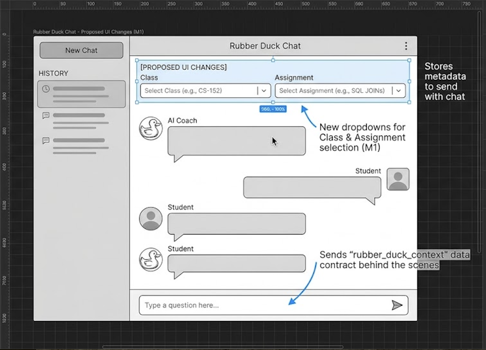
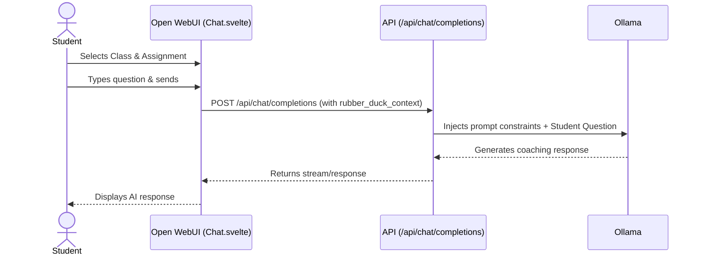

[Documentation home]({{ '/' | relative_url }})

# Rubber Duck Frontend Engineering Design Document

**Document Version: 1.1**

## Executive Summary

Field       Information
Status      IN PROGRESS
Created     Date  October 30, 2026
Author      Frontend Team – Francis Sengele, Ivanna Otero, Zac Kimball
EDD Size    1–2 weeks (estimate)
Consulted   Backend Team (Cody, Zane, Anthony), Instructor Rachel and Joe


## Overview

### Problem

- Open WebUI provides a generic, blank chat interface.
 Students currently have no way to specify which class assignment they are working on before starting a conversation.
 Without knowing the specific assignment, the backend cannot load the correct context, constraints, 
 or "rubber duck" system prompts required to properly tutor the student.

### Technical Details
- We need to map out the view/component hierarchy (navigation, pages, forms). 
  More importantly, we need to define the API contracts with the back-end team. 
  We can't build our HTTP requests or UI models until we know exactly what JSON payload 
  they are sending us and what they expect us to send back.

### Key Frontend Objectives
- The frontend must create a user experience that encourages problem-solving through guidance, hints, 
  and coaching rather than answer delivery.
- A scalable component architecture must be designed to support assignment views, 
  chat interactions, navigation, progress tracking, and future educational features
  without requiring major UI redesigns.
- Clear API contracts are needed so frontend engineers can build reliable data models, request
  handlers, and error states that properly communicate with backend services.
- The success of the product depends heavily on usability, accessibility, 
  and user engagement, requiring specialized frontend engineering to transform backend AI 
  functionality into an intuitive learning platform that students will actually use effectively.

### Problem Statement — Frontend

Open WebUI already has a chat system. Students can type questions and receive AI responses.
However, the chat does not currently have a way for students to select the homework assignment they need help with.
For Milestone 1, we want students to select the SQL Joins assignment from Principles of Relational Databases.
The frontend must send the selected assignment information to the backend so the AI can give help related to that assignment.
The AI should guide students and help them understand what to try next, not simply give them the homework answers.


### Proposed Solution

We plan to add two dropdown menus to the Open WebUI chat page:
Select Class: Principles of Relational Databases
Select Assignment: SQL Joins
We will use the existing Chat.svelte component.
The selected values will be stored in two variables:
selectedClassId
selectedAssignmentId
The frontend will send these values to the backend using the existing chat API.
We will use the rubber_duck_context structure agreed on with the backend team.
This approach allows us to reuse the existing Open WebUI chat system without building a new chat interface.


## Frontend Technical Problem

- Open WebUI has an existing chat interface, but M1 requires a way for students to select
  the supported SQL JOIN assignment.
  
- Integrating a new assignment selection mechanism into the existing layout must be done
  without disrupting the core chat UX or requiring a massive UI overhaul.
  
- The current Open WebUI architecture couples chat initiation and message submission tightly,
  making it complex to securely inject assignment context before a chat session officially begins.
  
- Open WebUI's native API payloads do not natively support custom education metadata (like class or assignment IDs),
  creating a data transmission bottleneck between the frontend and the AI backend.

## Proposed Solution

- Add an assignment selection UI using Svelte components.
- Display the supported SQL JOIN assignment clearly to students.
- Connect the selected assignment to the homework help chat.
- Investigate the existing chat submission API and reuse it if appropriate.
- Work with the backend team to agree on the assignment data format.

## Technical Design

### Technical Decisions Still Needed

- Which Svelte component should we modify?
- Should assignment information come from the backend or be defined in the frontend for M1?
- Which API should carry the selected assignment?
- How should the assignment be associated with the chat session?


### Overview

Our Frontend team will modify the existing Open WebUI chat interface.
We found the main chat component in Chat.svelte. We will add two dropdown menus
so students can select a class and an assignment before asking a question.
The frontend will send the selected information to the backend using the existing chat API.

**Proposed UI Sketch:**



### Technical Details

#### System Diagrams

Here is the sequence diagram showing how the frontend interacts with the 
backend:




#### APIs

We will use the existing endpoint:
`POST /api/chat/completions`

Our teams agreed to use this data structure. It will be sent as part of the 
request payload:

```json
{
  "rubber_duck_context": {
    "class_id": "cpw-152",
    "assignment_id": "cp4-joins"
  }
}
```


#### Database

- Schema changes (tables, fields, indexes).
- Migrations and rollout plan.


#### Deployment

Since we are modifying an existing open-source project (Open WebUI), our 
deployment strategy will rely on Docker.

- **Automated steps:** GitHub Actions will run standard build and lint tests 
  on the `rubber-duck-cam-t` repository.
- **Containerization technology:** We will use Docker to build the modified 
  Open WebUI image.
- **Manual steps:** For M1, deployment to the staging environment will be 
  handled manually by pulling the latest Docker image and spinning up the 
  container.


## Out of Scope

Explicitly not included in Milestone 1:
- A custom-built chat UI from scratch (we are modifying Open WebUI).
- Backend prompt engineering or AI model selection.
- Saving user progress or chat history outside of Open WebUI's native SQLite 
  database.
- Authentication or single sign-on (SSO) integration.

  
## Observability

### Proactive

Metrics to track system health (latency, throughput, error rates):

- Alerts and thresholds.
- Health checks and dashboards.

### Reactive

- Logging strategy (structured logs, log levels).
- Debugging tools and workflows.


## Risks

### Open WebUI Upgrades Break Custom UI

#### Description
Because we are injecting custom code (`Chat.svelte`) into a third-party 
application, future version updates pulled from the upstream Open WebUI 
repository could overwrite or break our dropdown menus.

To mitigate the risk of breaking existing Open WebUI features, we will keep 
our custom UI components (the dropdowns) modular and separate from the core 
chat logic as much as possible. All modifications to `Chat.svelte` will be 
heavily documented. By adhering strictly to the agreed-upon 
`rubber_duck_context` data contract, we minimize the risk of frontend/backend 
integration failures.

## Timeline & Scope

**Scope for M1:**
- Design and integrate Class and Assignment dropdown menus into the existing 
  Open WebUI chat interface (`Chat.svelte`).
- Capture the user's selection and append it to the chat submission API 
  payload.
- Ensure the UI remains responsive and accessible.

**Estimated Timeline:**
- **Week 1:** UI implementation of the dropdowns and state management.
- **Week 2:** API payload integration and syncing with the backend data 
  contract.
- **Week 3:** End-to-end testing, bug fixes, and final review before merging 
  M1 to main.
